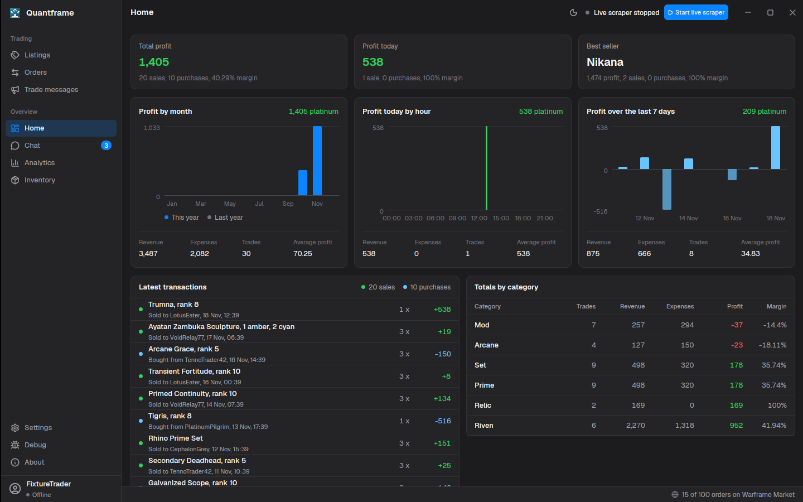
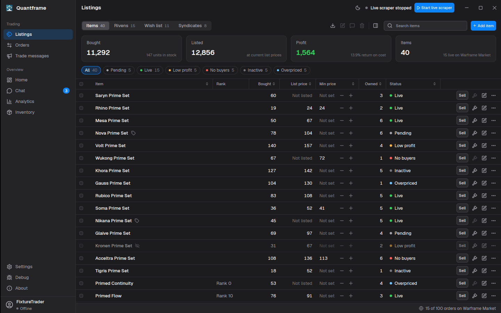
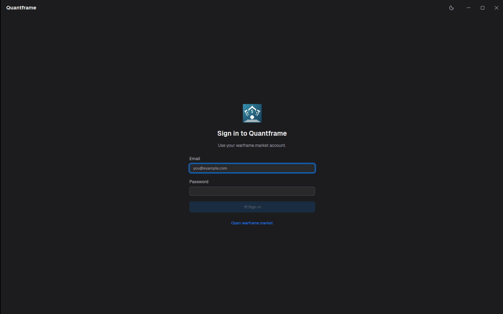

# QuantFrame

QuantFrame is a Warframe trading app. This fork adds a GPUI desktop interface. Kenya-DK created the original app. eyeveil and the QuantFrame contributors maintain this fork.

## GPUI screenshots







[Browse all GPUI screenshots](docs/screenshots).

## Run the GPUI app on x86-64 Linux

From the repository root, build the app in the Nix development shell.

```bash
nix develop -c cargo build --release --locked --manifest-path app-gpui/Cargo.toml
```

Open the app with sample listings, orders, and trade messages. Fixture mode uses a temporary database and runs without a market account.

```bash
nix develop -c env QF_FIXTURES="$PWD/src-tauri/fixtures" app-gpui/target/release/quantframe
```

To use your own account, start the binary without `QF_FIXTURES`.

## Copy an existing profile

The fork stores its database, settings, and logs in `dev.quantframe` under your local data directory.

- Linux: `${XDG_DATA_HOME:-$HOME/.local/share}/dev.quantframe`
- macOS: `~/Library/Application Support/dev.quantframe`
- Windows: `%LOCALAPPDATA%\dev.quantframe`

To keep your existing profile, close both apps. Copy `dev.kenya.quantframe` to `dev.quantframe` in the same parent directory. If `dev.quantframe` already exists, back it up before replacing it.

## Tauri app

Inspired by [Akmayer's Warframe-Algo-Trader](https://github.com/akmayer/Warframe-Algo-Trader), this is a re-implementation using tauri. Tauri allows for easy distribution to windows & linux without technical knowledge.

## Features

- Distribute as windows
  - Install size: 35MB
  - Idle resource consumption: 60MB, extremely small cpu footprint (on my rig, 0-0.1%)
  - Update distribution
- Store trading data in SQLite.
- Api client to communicate with wf.market
- Easy debugging / developer experience via edge dev tools

## Installation

### Download installer

The [upstream releases](https://github.com/Kenya-DK/quantframe-react/releases) ship the original Tauri app. Build this fork from source.

### OR Build it from source

If you prefer to build it locally for whatever reason, heres what you need:

#### Step 1. Install Pre-Requisites

Follow the [Tauri Pre-requisites](https://tauri.app/v1/guides/getting-started/prerequisites) guide to get necessary dependencies.

> If you're using **Windows**, you CANNOT use WSL for this project. You MUST install pre-requisites on windows, not WSL.

You will also need to make sure you've got Nodejs installed.

#### Step 2. Download code

I would strongly recommend installing [git](https://git-scm.com/) or [Github Desktop](https://desktop.github.com/) and use those to download the project source code from github. The reason is this will allow you to download new versions of the code much easier than clicking "download zip" every time.

##### Step 2.1. Delete

delete the `pubkey` filed in `tauri/src-tauri/tauri.conf.json`.

##### Step 2.2 Copy the 'PRODUCTION_URL' to 'DEVELOPMENT_URL' field in `tauri/src-tauri/qf_api/src/client.rs`.

#### Step 3. Build the project

Open a terminal at the project root and run:

<details>
<summary>
<i>How do I do this on windows?</i>
</summary>

On windows, this is easily done by click the path:


Then type in `powershell` and hit enter


</details>

```bash
pnpm i # Install nodejs deps
pnpm run tauri build
```

> For developers, you can also use yarn or pnpm if you prefer. (pnpm is the fastest package manager)

## About the project

This project uses:

- [Tauri](https://tauri.app): like electron but using a [Rust](https://www.rust-lang.org/) backend and doesn't use Chromium, leading to better performance.
- [React](https://react.dev/): For the frontend.
- [Mantine](https://mantine.dev/): use for the UI.
- [Sqlite](https://www.sqlite.org/index.html): For the database.
